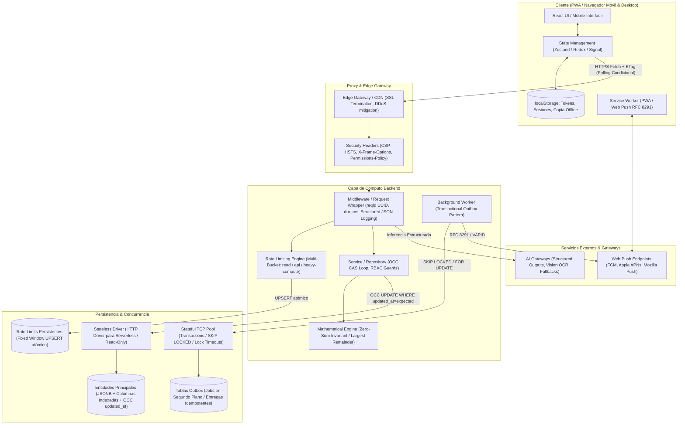

# Playbook de Transferencia de Conocimiento, Arquitectura y Auditoría Técnica

> **PROPÓSITO DE ESTE ARCHIVO:**  
> Este documento es un manual exhaustivo y portátil de arquitectura de software, ciberseguridad, experiencia de usuario y resiliencia para aplicaciones web colaborativas y transaccionales en tiempo real.
> 
> **CÓMO USARLO EN CUALQUIER PROYECTO:**
> 1. **Para Antigravity / Codex:** Copia este archivo o su mandato a la raíz de tu proyecto con el nombre `AGENTS.md`.
> 2. **Para Claude Code:** Guárdalo como `CLAUDE.md` en la raíz.
> 3. **Para Cursor:** Copia las directivas en `.cursorrules` o `.cursor/rules/`.
> 4. **Para GitHub Copilot:** Guárdalo como `.github/copilot-instructions.md`.
>
> **MANDATO DE ARQUITECTURA PARA EL AGENTE:**  
> Antes de responder consultas, diseñar soluciones o modificar código en este repositorio, **DEBES revisar y cumplir estrictamente los estándares, patrones de concurrencia, invariantes matemáticas y directrices de seguridad documentadas aquí**.

---

## 1. Topología del Sistema y Flujo de Datos Extremo a Extremo



---

## 2. Inventario de Referencia y Selección Tecnológica

| Componente / Librería | Capa | Problema que resuelve | Decisión de diseño recomendada frente a alternativas |
| :--- | :--- | :--- | :--- |
| **Framework Web / SSR** | Fullstack | Routing, Server Components, API routes | Serverless con App Router (Next.js/Remix). Despliegues inmutables y cómputo bajo demanda. |
| **Persistencia Principal** | DB / Storage | Persistencia relacional + datos dinámicos | PostgreSQL (híbrido relacional + JSONB). Permite consultas SQL rápidas y flexibilidad sin rigidez en entidades secundarias. |
| **ORM / Query Builder** | Backend | Type safety en queries y migraciones | Drizzle ORM o Kysely. SQL explícito, determinista y sin el overhead de memoria/runtime de Prisma. |
| **Testing DB en Memoria** | Testing | Pruebas de integración rápidas sin Docker | PGlite (Postgres en WebAssembly) o SQLite en memoria para correr suites completas de SQL en segundos. |
| **Manejo de Estado Cliente** | Frontend | Estado global desacoplado | Zustand o nanostores. Tamaño mínimo (<1KB), fuera del árbol de React, con soporte de updates optimistas y rollback granular. |
| **SDK de IA / LLM** | Backend | Extracción y automatización | AI SDK con Structured Outputs (`jsonSchema`). Rechaza respuestas ambiguas y fuerza esquemas contables exactos. |
| **Notificaciones Push** | Background | Alertas en segundo plano | Web Push estándar (VAPID + RFC 8291). Sin proveedores privativos (Firebase/OneSignal) ni rastreo invasivo. |
| **Validación de Esquema** | Borde / API | Sanitización de payloads entrantes | Zod o ArkType. Validación con uniones discriminadas (`discriminatedUnion`) en tiempo de ejecución en cada endpoint. |

---

## 3. Playbook de Arquitectura y Lecciones Críticas por Dominio

### A. Ciberseguridad & Resiliencia

1. **Tokens Criptográficos en URL Fragments (`#k=...`):**
   - Para accesos administrativos sin registro de usuario (autenticación sin contraseña), generar tokens de alta entropía (`crypto.randomBytes(32)`).
   - Guardar solo el hash SHA-256 en base de datos.
   - Entregar el enlace de control al usuario utilizando **fragmentos de URL** (`#k=token`), **NUNCA parámetros de consulta (`?k=token`)**.  
     *Razón:* Los fragmentos de URL jamás viajan al servidor en peticiones HTTP, evitando filtraciones en logs de proxies, balanceadores, CDNs y en la cabecera `Referer`.
2. **Comparación en Tiempo Constante:**
   - La validación de credenciales DEBE usar `crypto.timingSafeEqual` sobre buffers de igual longitud para neutralizar ataques de temporización (*timing attacks*).
3. **Autorización Fail-Closed:**
   - Si un usuario emite una acción y no se encuentra un token hash registrado o este no coincide, la petición debe rechazarse de inmediato con `403 Forbidden`. Jamás asumir permisos si el registro está ausente.
4. **Prevención de SSRF en Notificaciones / Webhooks:**
   - Los endpoints remotos configurados por usuarios o navegadores deben validarse contra una lista blanca cerrada de dominios permitidos (ej. `fcm.googleapis.com`, `apple.com`, `mozilla.com`).
   - Las claves criptográficas públicas deben validar longitud fija en bytes y cabeceras de compresión válidas (ej. byte `0x04` para curvas elípticas P-256).
5. **Gobernanza de Rate Limiting Adaptada a Entornos Compartidos (NAT / WiFi):**
   - Cuando múltiples clientes se conectan desde un mismo establecimiento comercial (oficina, bar, cafetería), todos comparten una única IP pública.
   - **Regla:** Desacoplar baldes de lectura y escritura:
     - Balde `read`: Límite amplio (~1.200 req/min) para permitir el sondeo de decenas de dispositivos simultáneos sin bloqueo.
     - Balde `api`: Límite moderado (~120 req/min) para mutaciones.
     - Balde `heavy / ia`: Límite estricto con política **Fail-Closed** (si el rate limiter falla, la petición pesada se rechaza para evitar costos no deseados de API).
6. **Hardening de Cabeceras HTTP:**
   - `Content-Security-Policy`: Sin comodines externos, `frame-ancestors 'none'`.
   - `X-Frame-Options: DENY`.
   - `X-Content-Type-Options: nosniff`.
   - `Strict-Transport-Security: max-age=31536000; includeSubDomains; preload`.
   - Desactivar rutas comodín remotas en optimizadores de imágenes para mitigar SSRF.

---

### B. UI / UX & Experiencia de Usuario

1. **Flujo de Transacciones en Tres Fases (Doble Atestación):**
   - No dar por completada una transacción por la simple declaración de una de las partes.
   - Fase 1 (Deuda activa): El usuario ve lo que debe.
   - Fase 2 (Notificación): El emisor declara que realizó la transferencia/pago. Se suspenden los recordatorios.
   - Fase 3 (Confirmación): El receptor valida la acreditación en su entidad financiera y confirma o disputa. Solo tras la confirmación se impacta el saldo consolidado (`confirmedAmount`).
2. **Resiliencia ante Desconexión & Modo Stale:**
   - Si la red falla, la UI debe alternar a una copia local en caché (`localStorage`), advirtiendo claramente al usuario: *"Sin conexión. Mostrando última copia conocida."*
   - Si el servidor responde un `404 Not Found` definitivo, purgar la caché local para evitar que la aplicación reviva entidades inexistentes.
3. **Diseño de Alto Contraste y Accesibilidad (A11y):**
   - Contrastes verificados (WCAG 2.1 AA/AAA): mínimo 4.5:1 para texto normal, 7:1 para secundario y >13:1 para botones de acción principal.

---

### C. Frontend Architecture & Concurrencia en Cliente

1. **Reversión Granular de Actualizaciones Optimistas:**
   - En interfaces colaborativas en tiempo real, cuando una acción optimista falla o es rechazada por el servidor, **NO revertir la entidad completa**.
   - Revertir únicamente los campos específicos que esa acción intentó modificar (`revertOptimisticFields`). De lo contrario, se borrarán del cliente las modificaciones hechas en paralelo por otros usuarios durante la ventana de red.
2. **Higiene de Almacenamiento Local (Evitar `QuotaExceededError`):**
   - Descartar blobs pesados (imágenes Base64, QRs) antes de persistir registros en `localStorage`.
   - Implementar poda automática: máximo de N entidades recientes y tiempo de vida limitado (TTL de 72 horas).

---

### D. Backend Architecture & Persistencia

1. **Control de Concurrencia Optimista (OCC) con Monotonía Temporal:**
   - Usar Compare-And-Swap (CAS) en actualizaciones:
     ```sql
     UPDATE entity SET ..., updated_at = $newUpdatedAt
     WHERE id = $id AND updated_at = $expectedUpdatedAt
     RETURNING id;
     ```
   - Si no hay match (conflicto real de concurrencia), releer y reaplicar la mutación.
   - Si la base de datos devuelve error de red o infraestructura, **lanzar una excepción que devuelva HTTP 503**, NUNCA devolver `false` (conflicto simulado), pues dispararía reintentos que duplicarían operaciones en caso de confirmaciones no reconocidas.
   - Asegurar que `updatedAt` avance siempre al menos una unidad (`Math.max(Date.now(), original + 1)`) para evitar colisiones en el mismo milisegundo.
2. **Invariante Matemática de Suma Cero (Método de Mayor Resto / Hare-Hamilton):**
   - Al repartir montos discretos (dinero, asientos, recursos):
     $$\sum_{i=1}^n \text{reparto}(Total, Pesos)_i = Total$$
   - Distribuir primero las partes enteras (`Math.floor`); luego repartir el sobrante de a 1 unidad a los mayores restos fraccionarios con desempate determinista por índice. Jamás usar `Math.round(total / N)` de forma independiente por participante.
3. **Patrón Outbox para Procesamiento Asíncrono sin Dependencias Externas:**
   - Para tareas diferidas o recordatorios en arquitecturas serverless sin Redis:
     ```sql
     SELECT * FROM jobs WHERE status = 'pending' AND due_at <= $now
     ORDER BY due_at LIMIT $batch
     FOR UPDATE SKIP LOCKED;
     ```
   - Configurar `SET LOCAL lock_timeout = '2s'` para evitar contenciones.
   - Recalcular siempre el estado de la deuda en tiempo de ejecución antes de emitir la alerta exterior.
4. **Trazabilidad y Observabilidad Estructurada:**
   - Envolver todos los endpoints de API en un wrapper unificado que asigne un Correlation ID único (`reqId` UUID).
   - Loguear una única línea JSON con `{ ts, level, event, reqId, route, method, status, dur_ms }`.
   - En errores 500 no controlados, retornar al cliente el `reqId` para soporte técnico y registrar el stack trace completo únicamente en los logs del servidor.

---

## 4. Checklist para Nuevos Proyectos

- [ ] **1. Contrato Numérico Estricto:** Decidir si los importes se modelan en enteros (menor unidad: centavos) o decimales fijos, e implementar el método del mayor resto para prorrateos.
- [ ] **2. Validaciones en el Borde con Zod:** Validar el 100% de los payloads entrantes en tiempo de ejecución antes de pasarlos a la lógica de negocio.
- [ ] **3. Aislamiento de Base de Datos para Tests:** Usar PGlite (PostgreSQL WASM en memoria) o SQLite en memoria para que los tests unitarios e integraciones corran en segundos sin dependencias externas.
- [ ] **4. Concurrencia Segura:** OCC con columnas de versión o timestamps con avance monotónico forzado.
- [ ] **5. Hardening de Red:** Configurar CSP estricta, baldes de rate limit diferenciados para entornos NAT/WiFi y protección contra SSRF.
- [ ] **6. Observabilidad con Correlation IDs:** Todo log estructurado en JSON y con `reqId` inyectado por middleware.
- [ ] **7. Arquitectura de UI Modular:** Componentes pequeños (<400 líneas), modales con lazy-loading (`dynamic()`) y rollback optimista granular.
